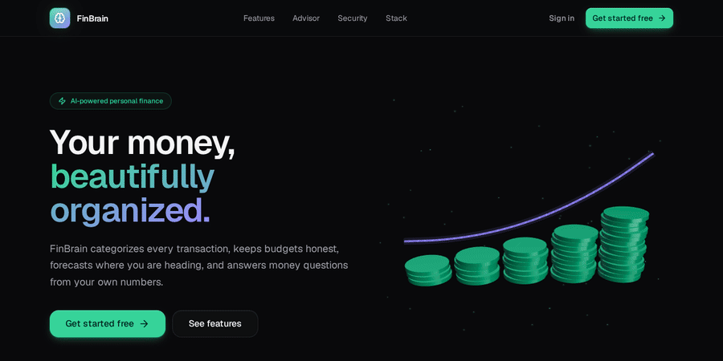
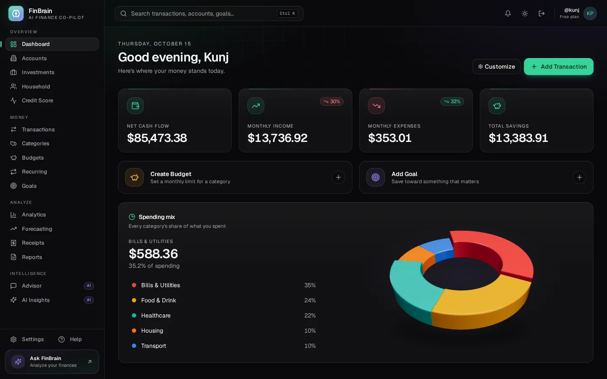
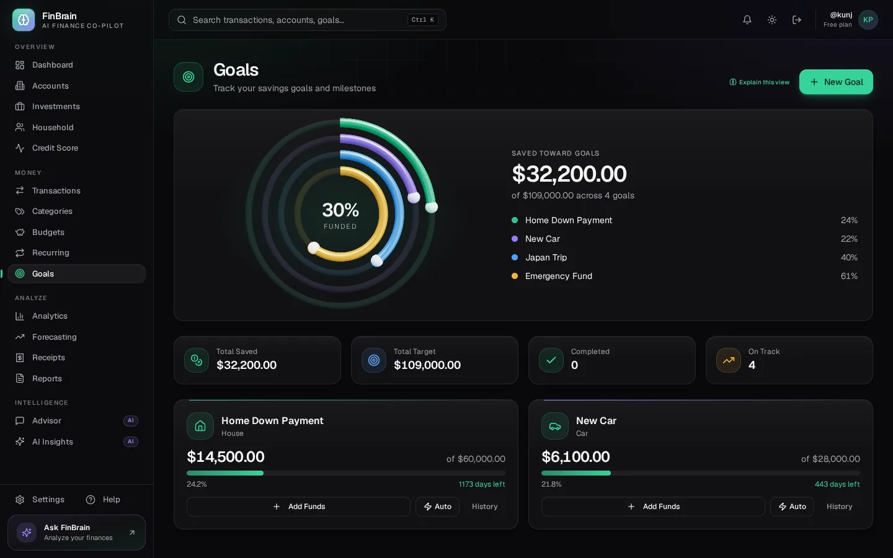
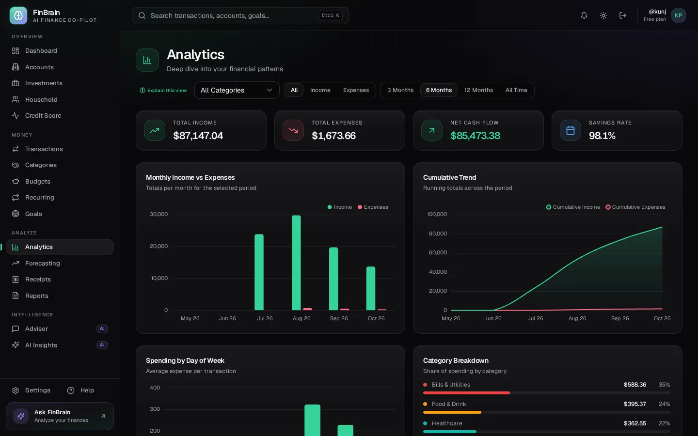
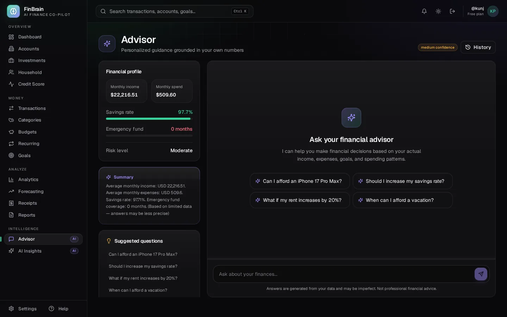
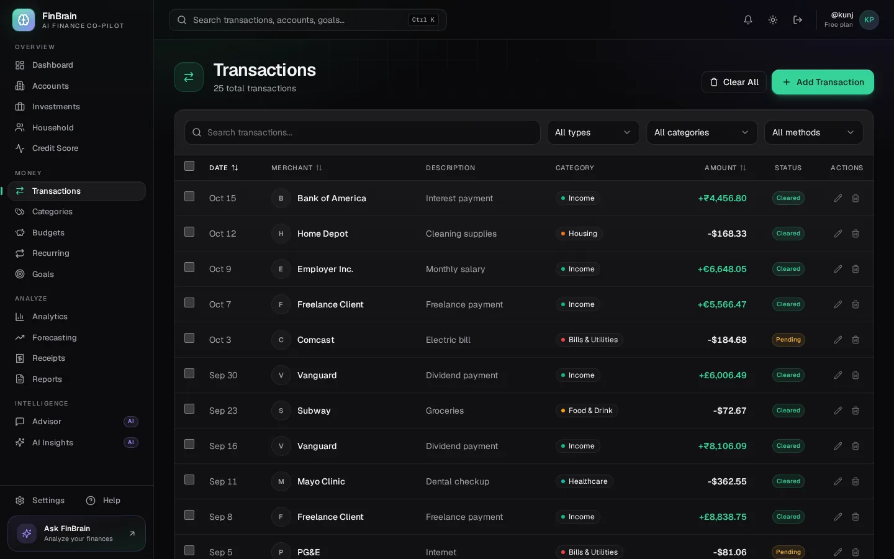
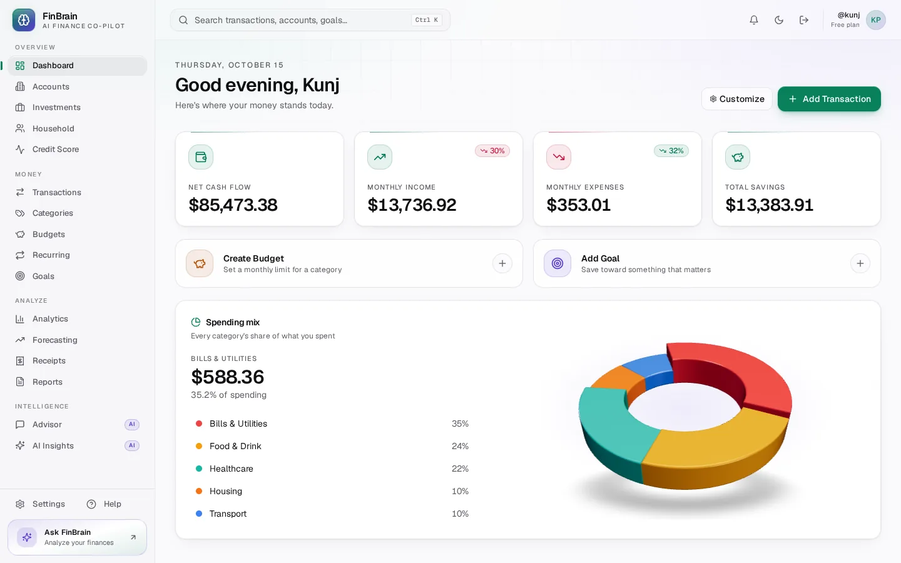

<div align="center">
  <br/>
  
  <h1 align="center">FinBrain</h1>
  <p align="center">
    <strong>AI-Powered Personal Finance Co-Pilot</strong>
  </p>
  <p align="center">
    A full-stack personal finance dashboard that combines bank and file import, machine-learning
    categorization, budgeting, forecasting and an AI advisor in one application.
  </p>
  <br/>
</div>

<div align="center">
  
  
  
  
  
  
  
  
  
</div>

<p align="center">
  <a href="https://kunj157.github.io/FinBrain/"><strong>Live site:</strong> kunj157.github.io/FinBrain</a>
</p>

<p align="center">
  
</p>

---

## Screenshots

| Dashboard | Goals |
|---|---|
|  |  |
| **Analytics** | **Advisor** |
|  |  |
| **Transactions** | **Light theme** |
|  |  |

A short recording of the 3D hero is also available as [MP4](docs/media/hero.mp4).

---

## Overview

FinBrain is a full-stack AI-powered personal finance tracker built as a monorepo. It combines ML-powered transaction categorization (XLM-RoBERTa, 86.5% test accuracy once the weights are trained), an LLM financial advisor (Groq/OpenAI), German bank PDF parsing, investment portfolio tracking, and a premium light and dark interface with motion and 3D into a single application.

### Core Philosophy

- **AI-first categorization** — XLM-RoBERTa transformer with 100+ keyword fallback, not rigid rule sets
- **Personal financial advisor** — LLM answers questions with reasoning based on your complete financial context
- **Data-first onboarding** — Import via Plaid, CSV, or German bank PDFs before anything else
- **Adaptive budgets** — Learn from your spending, alert at thresholds, rollover support

### Interface

- **Design system** — light and dark themes built from HSL tokens, with money semantics (positive, negative, warning, info), an AI accent and a chart palette checked for colour-vision deficiency in both themes
- **Motion** — animated and sliding numbers, a sliding active indicator in navigation and tabs, scroll reveals, spotlight and 3D tilt on cards, a shimmer and travelling border while the AI works; all of it respects `prefers-reduced-motion`
- **3D** — an interactive landing hero, goal progress rings and a dashboard spending-mix ring (three.js via React Three Fiber), loaded lazily only when WebGL is available, paused off screen, with static fallbacks
- **Performance** — every page is code-split; the entry bundle is about 150 kB gzip
- **Accessible** — labelled controls, visible focus rings, real switches and sortable headers announced to screen readers

### Key Features

**Accounts and import**
- Secure authentication with Clerk
- Bank integration through Plaid (sandbox)
- CSV and PDF statement import, including German bank formats
- Receipt OCR with Tesseract
- Multi-currency support (7 currencies)

**Transactions and categorization**
- Transaction CRUD with search, filters and bulk operations
- ML auto-categorization (XLM-RoBERTa, 86.5% test accuracy) with a keyword fallback. The fine-tuned weights are not in the repository (see [ML model weights](#ml-model-weights)); without them the keyword categorizer does the work
- Category management with icons and colours, and a categorization rules engine
- Recurring transaction detection
- Data quality dashboard

**Budgets and goals**
- Adaptive budgets with rollover and alerts at 75, 90 and 100%
- Flex budgeting with fixed, non-monthly and flexible buckets
- Savings goals with auto-contribute and projections
- Recurring calendar view and bill reminders

**Insights and planning**
- Customizable drag-and-drop dashboard with summary cards
- Analytics by category, type, merchant and day of week, with Sankey money-flow diagrams
- Net worth tracking with historical trends and a financial health score
- Forecasting (Prophet, ARIMA, linear regression, moving average) and a 6-month cash flow projection
- Scenario simulator, spending pattern detection and anomaly detection
- Investment portfolio and holdings tracking, and credit score tracking

**AI advisor**
- Financial assistant (Groq or OpenAI) that reasons over your full financial context
- Persistent multi-turn chat backed by an advisor profile and memory layer
- Deterministic affordability engine
- AI insights and a weekly recap

**Reports and collaboration**
- Monthly, quarterly and annual reports with CSV and PDF export, plus a tax summary
- Couples and household accounts
- Notifications, global search (Cmd+K) and a mobile-responsive layout

---

## Tech Stack

```
┌────────────────────────────────────────────┐
│           React 19 + Vite 5                │
│  Tailwind CSS + Radix UI + Chart.js + nivo │
│   Motion + three.js (React Three Fiber)    │
│        TanStack Query + Groq / OpenAI       │
├────────────────────────────────────────────┤
│          Express + Prisma ORM              │
│              PostgreSQL                    │
├────────────────────────────────────────────┤
│      FastAPI + XLM-RoBERTa + sklearn       │
│   Tesseract OCR + Keyword Categorizer      │
├────────────────────────────────────────────┤
│  Plaid Sandbox + Multi-Currency (7)        │
│  German Bank PDF Parser                    │
└────────────────────────────────────────────┘
```

---

## Architecture

```
            React Frontend (Vite, PWA-ready)
                       │
                       ▼
              Vite Dev Proxy / Nginx
                       │
         ┌─────────────┴──────────────┐
         ▼                            ▼
  Express REST API             FastAPI ML Service
  (24 route files)            (categorization, OCR)
         │                            │
         ▼                            ▼
  PostgreSQL              XLM-RoBERTa + sklearn
  (31 Prisma models)      (86.5% test acc.)
         │
         ├── Clerk Auth (JWT verification)
         ├── Plaid Link (sandbox)
         ├── Auto-Categorize (100+ keywords)
         ├── Recurring Detection
         ├── Budget Alerts → Notifications
         └── AI Chat → Groq / OpenAI
```

---

## Project Structure

```
FinBrain/
├── apps/
│   ├── web/                  # React 19 + Vite frontend (design system, motion, 3D)
│   ├── landing/              # Static marketing site published to GitHub Pages
│   ├── api/                  # Express REST API (24 route files, 31 Prisma models)
│   └── ml-service/           # FastAPI Python ML service (XLM-RoBERTa + sklearn)
├── packages/
│   └── shared/               # Shared TypeScript types & interfaces
├── .github/workflows/        # CI/CD pipelines
├── docker-compose.yml        # Local development
├── docs/
│   ├── media/                # Screenshots and the hero recording (README + landing)
│   └── OPERATIONS.md         # Running in production
└── package.json              # Root workspace config
```

---

## Quick Start

### Prerequisites

- Node.js 20+
- pnpm 9+
- Docker & Docker Compose (optional)
- PostgreSQL 16 (optional — Docker recommended)

### Local Development

```bash
# Install dependencies
pnpm install

# Generate the Prisma client and create the schema
pnpm --filter @finbrain/api db:generate
pnpm --filter @finbrain/api db:push

# Optional: seed a demo user with transactions
pnpm --filter @finbrain/api seed

# Start in dev mode (web on :5173, api on :4000)
pnpm dev

# Or start everything with Docker
docker compose up
```

Without a Clerk key the web app signs you in as a local development user, which is the quickest way to try it.

### Checks

```bash
pnpm lint && pnpm typecheck   # every workspace
pnpm test                     # API (Vitest + PostgreSQL) and web component tests
pnpm test:e2e                 # Playwright, starts the API and web app itself
pnpm build
```

### Landing page

```bash
pnpm --filter @finbrain/landing dev     # http://localhost:5190
PAGES_BASE_PATH=/FinBrain pnpm --filter @finbrain/landing build
```

The `landing` workflow publishes it to GitHub Pages on every push to `main` or `dev` that touches it.

### Environment Variables

Copy the example env files and fill in your keys:

```bash
cp .env.example .env
cp apps/web/.env.example apps/web/.env
cp apps/api/.env.example apps/api/.env
```

Needed to run at all:
- **PostgreSQL** — Database (local Docker or Cloud SQL)

Needed for production, optional locally:
- **Clerk** — Authentication ([clerk.com](https://clerk.com)). Required when `NODE_ENV=production`; in development without a key you are signed in as a local user.

Needed only for the matching feature:
- **Plaid** — Bank linking (sandbox mode) ([plaid.com](https://plaid.com)). CSV and PDF import work without it.
- **Groq** — LLM AI assistant (free tier, no credit card) ([groq.com](https://groq.com))
- **OpenAI** *(optional)* — Fallback LLM if Groq is unavailable

---

## ML model weights

The 86.5% figure is the held-out test accuracy recorded in `apps/ml-service/data/training_metrics.json` (4,000 samples, 10 categories). The repository contains the model's `config.json` and tokenizer but not `model.safetensors`, which is git-ignored for size. Train it with `apps/ml-service/scripts/train_xlmr.py`. Without the weights the ML service returns no prediction and the API falls back to the keyword categorizer.

---

## Running in Production

See [OPERATIONS.md](./docs/OPERATIONS.md) for health and readiness probes,
structured logging, required configuration, and the backup and restore
procedure (including how to verify a restore actually works).

---

## Branch Strategy

| Branch | Purpose |
|--------|---------|
| `main` | Stable releases |
| `dev` | Active development — all tested code |
| `feature/*` | Feature branches merged into `dev` |

---

## License

[MIT](./LICENSE)
